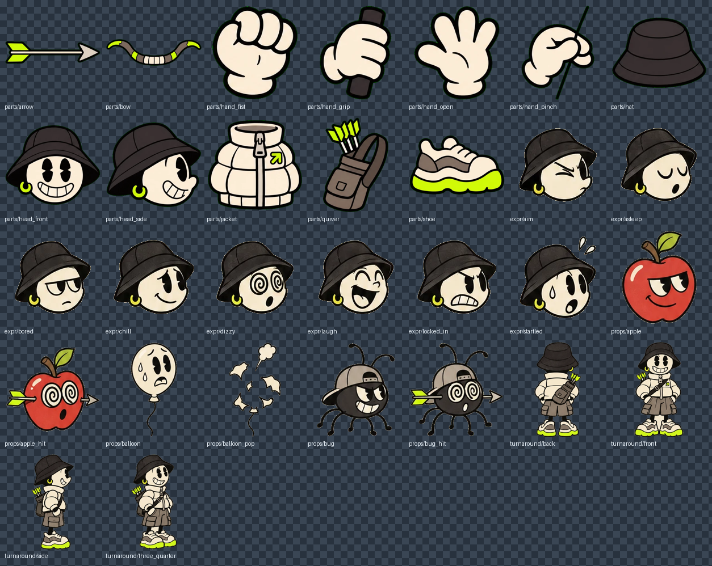

# Pip

> **一隻會妨礙你工作的桌面寵物。**
>
> **生產力：−150%。干擾程度：200%。**
>
> *A desktop pet that gets in the way of your work. Productivity −150%. Distraction 200%.*



Pip 是一隻站在你工作列上的橡皮水管弓箭手。Claude Code 在幫你寫程式的時候，Pip 在對你的游標射箭。

## 為什麼你不該裝它

- **箭會朝你的游標飛過來。** 正常人會下意識把滑鼠移開，然後忘記自己剛剛要點什麼。
- **游標上永遠掛著一個東西。** 蘋果和蟲子會每隔幾秒對你吐舌頭、用手指頂鼻子挑釁；氣球會摀著嘴一直發抖，看了也不太舒服。
- **Claude 越認真工作，Pip 射得越兇。** 每一次工具呼叫都是一輪瘋狂連射，箭沿拋物線飛過你所有的視窗。
- **它不能被關進角落。** 全螢幕透明、永遠置頂。
- **開發者本人錄完展示影片就關掉了。**

## 那它到底能幹嘛

好吧，其實看一眼就知道 Claude 在做什麼——只是很吵：

| Claude 在做什麼 | Pip 的動作 |
|---|---|
| 對話開始 | 待命，頭跟著你的滑鼠轉 |
| 開始思考 | 瞇眼拉弓 |
| 用工具 | 瘋狂連射；姿勢依工具分四類（改檔、讀檔、查網路／外部工具、其他指令） |
| 問你問題、等你批准計畫 | 盯著你等 |
| 派出子代理 | 多一個小弓箭手一起射，子代理跑完就離開 |
| 回答完成 | 握拳慶祝 |
| 出錯 | 頭暈，弓斷掉 |
| 對話結束 | 睡著 |

- **箭袋**＝ context 還剩多少；**體力**＝額度還剩多少。
- 閒著的時候，Pip 會瞄準你游標上的東西射。射中了蘋果和蟲子會掉下去，氣球會爆。
- 滑鼠會**穿過** Pip 以外的地方，照常點後面的程式；移到 Pip 身上可以摸摸頭，甩滑鼠牠會嚇到閃開。
- 右下角系統匣有 Pip 圖示：顯示／隱藏、結束。結束是最常用的功能。

## 架構

```
Claude Code ──(Mod: pip-bridge)──▶ http://127.0.0.1:38917/state ──▶ Tauri (Rust) ──emit──▶ Canvas
```

| 層 | 技術 | 位置 |
|---|---|---|
| 桌面視窗 | Tauri 2（Rust）：全螢幕透明、置頂、不進工作列；每 30ms 輪詢游標、tiny_http 收狀態、系統匣 | `pet/src-tauri/` |
| Pip 本身 | 單檔 HTML + Canvas，零框架：貼圖零件＋程式畫的橡皮水管手腳、節拍彈跳、彈道射擊、Verlet 擺盪 | `prototype/pip.html` |
| 接上 Claude | Claude Code Mod **pip-bridge**（在 [ClaudeMods](https://github.com/youllook/ClaudeMods/tree/main/plugins/pip-bridge)） | 另一個 repo |
| 素材 | 角色圖用 AI 生成，Python（numpy + Pillow）去背切零件 | `assets/`、`tools/`、`prompts/` |

## 安裝與執行（Windows）

需要 [Rust](https://rustup.rs/)、Node.js、WebView2（Windows 10/11 內建）。

```bash
cd pet
npm install
npm run sync          # 把 prototype/pip.html 和 assets 複製進 dist/
npm run build         # 產出 release 執行檔
```

執行 `pet/src-tauri/target/release/pip-pet.exe`，Pip 會出現在主螢幕右下角。

接著裝 Mod，讓 Pip 跟著 Claude 動：

```bash
claude plugin marketplace add youllook/ClaudeMods
claude plugin install pip-bridge@claude-mods
```

沒裝 Mod 也能手動玩：

```bash
curl "http://127.0.0.1:38917/state?mode=exec&tool=Bash"
```

參數：`mode`＝`away|idle|think|exec|wait|ok|err`，`tool`＝`Bash|Edit|Read|WebSearch`，`arrows`＝0–20，`stamina`＝0.1–1，`sub`＝`+|-`。

## 只想看動畫

不用編譯，直接在瀏覽器開原型（數字鍵 1–7 切狀態）：

```bash
python -m http.server 4317 --bind 127.0.0.1
# 開 http://127.0.0.1:4317/prototype/pip.html
```

`prototype/archer.html` 是最早的像素風版本。

## 已知限制

- 只在主螢幕顯示（你的第二螢幕是安全的）。
- 目前只測過 Windows。
- 會妨礙你工作。這不是 bug。

## 授權

[MIT](LICENSE)，程式碼與角色素材皆同。
